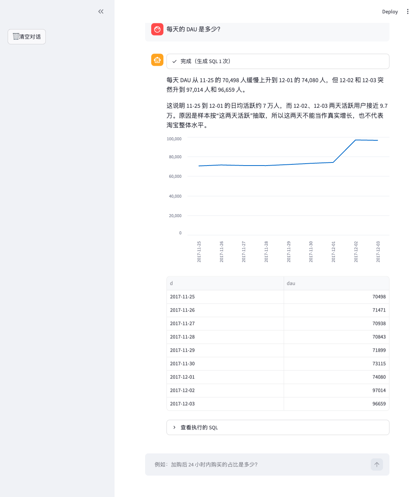
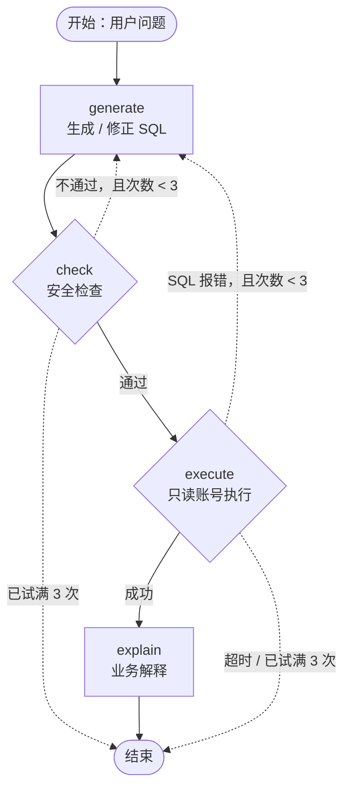

# 淘宝用户行为 ChatBI：用 LangGraph 搭建的自然语言问数系统

用中文提问，比如"加购过的用户有多少比例最后购买了？"，系统会依次完成以下几步：

1. 根据**表结构和指标口径**自动生成 MySQL 查询
2. 做**安全检查**：只允许 SELECT 语句，只能查白名单里的表，自动补上 LIMIT
3. 用**只读账号**执行，设有超时
4. 如果出错，把报错交给模型**自动修正**，最多 3 次
5. 用业务语言**解释**结果，并主动提示数据偏差和结果是否被截断

数据是阿里天池 UserBehavior 数据集中 10% 的用户，约 998 万条行为记录，时间范围为 2017-11-25 至 12-03。

**在线演示**：https://taobao-chatbi.streamlit.app （每次提问都会消耗作者的模型额度，所以需要访问密码，如需试用请联系作者）



## 架构

用 LangGraph 构建的有状态图。实线是正常流程，虚线是出错后的分支：



| 概念 | 在本项目中 |
|---|---|
| **State** | 问题、SQL、报错、报错类型、尝试次数、查询结果、知识文本、最终解释 |
| **Node** | `generate`：首次生成，或带着报错修正 SQL；`check`：sqlglot 语法树校验；`execute`：只读执行；`explain`：业务解释 |
| **Conditional edge** | 校验不通过或 SQL 报错时，回到 `generate` 重写；**超时不重试**，因为这属于性能问题，靠索引解决；最多尝试 3 次，防止死循环 |

## 核心设计

**1. 知识层：把指标口径写进 prompt**

text-to-SQL 最危险的错误不是报错，而是 **SQL 能执行，但口径不对**。比如"加购用户购买率"：

- 按"加购过且买过"计算是 72.13%
- 按"加购之后才购买"计算是 63.07%
- 按"用户×商品"计算只有 6.43%

这类错误不会触发任何报错，重试机制也发现不了。所以项目把表结构、指标定义和已知的数据偏差写成知识文件 [`knowledge/schema_and_metrics.md`](knowledge/schema_and_metrics.md)，作为 system prompt 的一部分。

**2. 两道安全防线**

| 防线 | 做法 |
|---|---|
| 数据库层 | 专用只读账号 `chatbi_ro`，只授予两张表的 SELECT 权限 |
| 代码层 | 用 [sqlglot](https://github.com/tobymao/sqlglot) 把 SQL 解析成语法树后校验：只允许单条语句；最外层必须是 SELECT；表必须在白名单内，禁止跨库访问；禁止 `INTO`；自动补 `LIMIT 1000`。另外设置 30 秒执行超时 |

用攻击用例测试时，发现并修复了一个漏洞：`WITH user AS (...) SELECT * FROM mysql.user` 能借同名临时表绕过白名单。见 [`lesson03_check_sql.py`](lesson03_check_sql.py)。

**3. 区分错误类型**

- 字段名写错这类**语义错误**：带上报错信息让模型重写。
- 执行超时这类**性能错误**：直接结束，因为重写通常没用。例如"每天的 DAU"一开始要跑 30.5 秒。用 `EXPLAIN` 查出是大量回表，加上覆盖索引 `(d, user_id)` 后降到 0.85 秒。

**4. 解释环节防幻觉**

- 模型只能引用查询结果里出现的数字。
- 涉及留存、付费率的问题，要提示抽样偏差。
- 结果达到 1000 行上限时，要告诉用户结果可能不完整，并建议换个问法。

## 评估

使用**执行准确率**：比较查询结果，而不是比较 SQL 文本。参考答案里的每个数值都必须出现在系统的查询结果中；比例允许四舍五入误差，人数、次数这类整数必须完全一致。

做了 A/B 对比：`full` 版本使用表结构 + 指标口径，`schema_only` 版本只给表结构。

| 测试集 | 题数 × 重复次数 | full | schema_only |
|---|---|---|---|
| 常规题（基础、口径、RFM、类目、路径） | 20 × 2 | **100%**（40/40） | 95%（38/40） |
| 口径陷阱题（留出集） | 10 × 3 | **100%**（30/30） | **70%**（21/30） |

- 口径陷阱题专门考验计数单位、分母、计数方式和时间条件的歧义。跑这组题时知识文件处于冻结状态，文件指纹为 `93ee7864`，用来说明测试期间没有针对题目修改过知识文件。
- `schema_only` 的 SQL 几乎全部能执行（96.7%），但准确率只有 70%。这说明口径错误会"悄悄"产生错误数字，靠报错重试解决不了。

题库在 [`eval/`](eval/) 目录，评估明细 CSV 也在那里。评估脚本是 [`lesson07_eval.py`](lesson07_eval.py)。

迁移到云端（TiDB Cloud）后，用 `full` 版本各复测了一次：常规题 19/20，陷阱题 10/10。常规题错的那 1 次是第 9 题，模型漏掉了"只统计加购用户"这个筛选条件。也就是说，即使给了口径定义，LLM 仍会偶尔出现逻辑疏漏。把本地和云端的运行合在一起算，`full` 版本的常规题准确率为 59/60（约 98%）。

**局限**：题目数量少；题目和知识文件由同一组人编写；判分规则对数值的匹配比较宽松。这些结果只能说明方向，不能作为严格的基准测试。

## 目录结构

代码按学习步骤拆成 8 课，每一课都可以单独运行：

| 文件 | 内容 |
|---|---|
| `lesson01_hello_llm.py` | 用 LangChain 调用 DeepSeek |
| `lesson02_generate_sql.py` | `ChatPromptTemplate \| llm \| StrOutputParser` 生成 SQL |
| `lesson03_check_sql.py` | 基于 sqlglot 的安全检查，附带攻击用例 |
| `lesson04_run_sql.py` | 只读执行 + 超时 |
| `lesson05_graph.py` | LangGraph：State、Node、条件边、重试循环 |
| `lesson06_explain.py` | 增加 explain 节点，提供统一入口 `ask()` |
| `lesson07_eval.py` | 评估：执行准确率、A/B 对比、多次重复运行 |
| `app.py` | Streamlit 界面：逐个节点显示进度，保存聊天记录 |
| `knowledge/` | 表结构与指标口径 |
| `eval/` | 评估题库与结果 |

## 运行

1. 安装依赖：

```bash
python3 -m venv .venv && source .venv/bin/activate
```
```bash
pip install -r requirements.txt
```

2. 配置环境变量：

```bash
cp .env.example .env
```

然后在 `.env` 中填写 DeepSeek API Key 和 MySQL 只读账号。模型通过 `langchain-openai` 以 OpenAI 兼容接口调用，改 `base_url` 和 `LLM_MODEL` 就能换成其他模型。

3. 准备数据：本仓库不包含数据。需要先把天池 UserBehavior 数据清洗后导入 MySQL 的 `taobao` 库，生成两张表 `ub`（行为明细）和 `user_rfm`（RFM 分层），字段说明见知识文件。建议建立索引 `CREATE INDEX idx_d_user ON ub (d, user_id)`。

4. 启动界面：

```bash
streamlit run app.py
```

也可以直接在命令行提问：`python lesson06_explain.py "复购率是多少？"`

## 云端部署

| 组件 | 做法 |
|---|---|
| 数据库 | **TiDB Cloud Starter**（兼容 MySQL，免费额度）。[`deploy/import_to_tidb.sh`](deploy/import_to_tidb.sh) 把本地数据拆成每份 50 万行，用 `LOAD DATA` 导入，再建索引、建只读账号；连接全程开启 TLS 并校验服务器证书 |
| 分析性能 | 免费版单条查询的内存有限，"用户×商品"这类千万行级别的分组会超出内存。用 [`deploy/enable_tiflash.sh`](deploy/enable_tiflash.sh) 开启 **TiFlash 列存**后，这类查询改走列存加 MPP 并行计算，5～6 秒就能完成（行存是 OLTP，列存是 OLAP） |
| 应用 | **Streamlit Community Cloud**，密钥放在 Secrets 里，启动时写入环境变量 |
| 防滥用 | 访问密码（`APP_PASSWORD`）+ 每个会话最多提问 20 次；模型账户只充少量余额。实测每个问题约 3,000～4,000 token，费用不到 1 分钱人民币，其中约 85% 的输入 token 命中了前缀缓存 |

本地和云端用同一套代码，只是读取的配置不同：用 `CHATBI_ENV=.env.cloud streamlit run app.py` 在本地连接云数据库。

## 技术栈

LangGraph · LangChain · DeepSeek（deepseek-flash）· sqlglot · MySQL / TiDB Cloud（TiFlash）· pandas · Streamlit
